# Development Plan: Dhruva Jaal (`ध्रुव जाल`) Version 1
## Step-by-Step Implementation Guide for the 3D Digital Twin & Autonomous LoRa Mesh
### Incorporating Technical Audit Traps & Defensive Architectural Fixes

**Target Completion Window:** Next 18–24 Hours  
**Input Specification:** [`version_1_master_proposal.md`](file:///c:/AI%20Native%20founder/Hackathon_projects/octo_gdg_hackathon/version_1_master_proposal.md)  
**Baseline Codebase:** [`version_0.md`](file:///c:/AI%20Native%20founder/Hackathon_projects/octo_gdg_hackathon/version_0.md) & [`technical_details.md`](file:///c:/AI%20Native%20founder/Hackathon_projects/octo_gdg_hackathon/technical_details.md)  
**Document Status:** Audited & Battle-Hardened Blueprint  

---

## 1. Architectural Guardrails & Tech Stack

To prevent breaking existing working features, eliminate dependency bloat, and guarantee 60 FPS on standard laptops:

* **Pure MapLibre GL JS (No Deck.gl / Threebox):** Avoid WebGL context conflicts and 600MB+ bundle size. All 3D elevation, extruded buildings, volumetric flood depth, and sky arcs will use native MapLibre `raster-dem`, vector `fill-extrusion`, and custom Canvas/SVG projective layers.
* **Pure Web Audio API (No Howler.js / External MP3s):** Synthesize authentic LoRa chirp spread-spectrum sweeps and radar sonar pings programmatically via oscillator nodes for zero load time and 100% offline reliability.
* **Deterministic Dual-Mode Routing:** Support both pre-scripted demonstration playback and dynamic **Geographic Forwarding Score** routing when judges inject custom SOS messages or sabotage nodes.

---

## 2. The 6 Audited Technical Traps & Defensive Countermeasures

Before writing code for Version 1, these 6 technical traps identified in the technical audit must be explicitly countered in our design:

| # | Technical Trap | Root Cause in MapLibre / JS | Defensive Countermeasure in Dev Plan |
|:---:|---|---|---|
| **1** | **`fill-extrusion` Buildings Fail on Raster Map** | Current `MapManager.js` uses ESRI raster tiles. Raster tiles lack polygon geometries and `render_height` properties. | Add OpenFreeMap planet vector source (`https://tiles.openfreemap.org/planet`) alongside the terrain source so `fill-extrusion` building blocks render natively. |
| **2** | **3D Terrain Clamps GeoJSON Lines to Ground** | MapLibre's native GeoJSON `line` layers drape flat onto the DEM mesh; they cannot curve upward into the air. | Render 3D Parabolic Sky-Arcs, vertical balloon tethers, and aerostat coverage cones in a screen-space HTML5 `<canvas>` / `<svg>` projective overlay mapped to `map.project([lon, lat])` with vertical altitude offsets ($y - \Delta h_{px}$). |
| **3** | **Geographic Forwarding Local Minima & Loops** | If a judge sabotages bottleneck nodes (e.g. $N_4, N_7$), greedy geographic routing can ping-pong between $N_2 \leftrightarrow N_5$ or lock in a dead-end. | Maintain a `visitedNodes` Set inside every active packet, enforce strict TTL ($10 \to 0$), and if all forward neighbors are severed, **fall back to `STORED` (Store-and-Forward)** on the current relay until aerial links come online. |
| **4** | **Timeline Scrubber Erasing Judge Custom SOS** | Reconstructing state purely from `scenario.json` wipes dynamic packets injected by the judge. | Store judge-injected messages in a dedicated `this.customSosList = []` array inside `ScenarioEngine.js`. If paused when sending, auto-call `this.play()` so the packet immediately hops. |
| **5** | **AudioContext Frame-Tick Audio Buzz / Crash** | Triggering sound effects inside a 60fps `requestAnimationFrame` tick loop spawns 60 overlapping oscillators per second. | Bind sound triggers **strictly to discrete event transitions** (`engine.on('sos')`, `engine.on('towers')`, and when hop index increments $k \to k+1$), never in the continuous tick loop. |
| **6** | **Web Serial Stream Partial Chunk Bug** | ESP32 serial data arrives in fragmented chunks (e.g. `"SEND|SO"` then `"S|Need boat\r\n"`). Parsing raw chunks directly throws JSON/string errors. | Pipe `port.readable` through `TextDecoderStream` and accumulate incoming characters in a persistent `lineBuffer` string, splitting only on `\n`. |

---

## 3. Updated Project File Map (`frontend/src/`)

```text
frontend/src/
├── main.js                     # Central coordinator: keyboard shortcuts, UI binding, audio triggers
├── hud.css                     # Tactical styling, phone drawer, sniffer bar, 3D overlays
├── config.js                   # LoRa physics, 433MHz Fresnel math, path loss calibration
├── audio/
│   └── SoundEngine.js          # [NEW] Pure Web Audio synthesizer (LoRa CSS chirp, sonar, sub-drop)
├── data/
│   └── scenario.json           # Kathmandu nodes, edges, timeline, coordinates, elevations
├── engine/
│   ├── DataSource.js           # Event emitter, WebSocket source + [NEW] Web Serial line-buffered bridge
│   ├── ScenarioEngine.js       # 100s timeline state machine + [NEW] customSosList & event hooks
│   └── RoutingEngine.js        # [NEW] Real-time Geographic Score calculation & loop-free solver
├── map/
│   ├── MapManager.js           # [UPDATED] AWS Terrarium 3D DEM, OpenFreeMap vector buildings, rising flood
│   ├── NodeLayer.js            # [UPDATED] 3D-aware node tags, Fresnel zone cards, aerial radar cones
│   └── LinkPacketLayer.js      # [UPDATED] Projective Canvas 3D Parabolic Sky-Arcs & Coverage Cones
└── ui/
    ├── Inbox.js                # [UPDATED] Base Camp Inbox + [NEW] "[🚁 Dispatch Rescue]" vector
    ├── Modals.js               # Context modal, Summary overlay, Honesty footer
    ├── SurvivorPhone.js        # [NEW] Floating interactive Android Survivor Phone + POV Camera
    └── SnifferBar.js           # [NEW] Collapsible LoRa PHY Sniffer & 433 MHz Airtime Duty-Cycle Meter
```

---

## 4. Four-Sprint Step-by-Step Implementation Roadmap

```mermaid
gantt
    title Dhruva Jaal V1 24-Hour Execution Schedule
    dateFormat  X
    axisFormat  Hour %X
    section Sprint 1: 3D Spatial
    3D Terrain DEM & Atmospheric Sky      :0, 2
    Vector Buildings & Rising 3D Flood    :2, 4
    Canvas 3D Sky-Arcs & Make-Before-Break:4, 6
    section Sprint 2: Interactive Sandbox
    Dynamic Geographic Forwarding Router  :6, 9
    Survivor Phone Drawer & POV Camera    :9, 11
    Click-to-Sabotage Chaos Mode          :11, 12
    section Sprint 3: RF Physics & Hardware
    433 MHz 1st Fresnel Zone Inspector    :12, 14
    LoRa PHY Sniffer & Duty-Cycle Meter   :14, 16
    Rescue Dispatch Vector Animation      :16, 17
    Line-Buffered Web Serial API Bridge   :17, 18
    section Sprint 4: Audio & Polish
    Discrete Web Audio Synthesizer        :18, 20
    Full UI Polish, Mute & Shortcuts      :20, 22
    Stress Testing & 3-Min Pitch Dry Run  :22, 24
```



---

### SPRINT 1: Zero-Bloat 3D Spatial Immersion (Hours 1–6)
*Goal: Turn the flat map into a defense-grade 3D Himalayan Digital Twin within the first 5 seconds.*

#### Step 1.1: AWS Terrarium 3D Himalayan DEM Topography
* **File:** [`frontend/src/map/MapManager.js`](file:///c:/AI%20Native%20founder/Hackathon_projects/octo_gdg_hackathon/frontend/src/map/MapManager.js)
* **Tasks:**
  1. Add native MapLibre `raster-dem` source using AWS Terrarium elevation tiles:
     ```javascript
     map.addSource('kathmandu-dem', {
       type: 'raster-dem',
       tiles: ['https://s3.amazonaws.com/elevation-tiles-prod/terrarium/{z}/{x}/{y}.png'],
       encoding: 'terrarium',
       tileSize: 256,
       maxzoom: 15
     });
     map.setTerrain({ source: 'kathmandu-dem', exaggeration: 1.25 });
     ```
  2. Add atmospheric `map.setSky({ 'sky-color': '#060d1a', 'fog-color': '#0d1829', 'fog-ground-blend': 0.7 })`.
  3. Ensure automatic graceful degradation: if tiles fail to fetch, cleanly revert to the tactical 2.5D offline grid.

#### Step 1.2: OpenFreeMap Vector Tile Buildings (Dodge Trap 1)
* **File:** [`frontend/src/map/MapManager.js`](file:///c:/AI%20Native%20founder/Hackathon_projects/octo_gdg_hackathon/frontend/src/map/MapManager.js)
* **Tasks:**
  1. Add OpenFreeMap vector tile source for building footprints:
     ```javascript
     map.addSource('openmaptiles', {
       type: 'vector',
       url: 'https://tiles.openfreemap.org/planet'
     });
     ```
  2. Add `fill-extrusion` layer referencing `source: 'openmaptiles'` and `source-layer: 'building'`:
     * Height: `['get', 'render_height']` (default $8\text{ m}$).
     * Color: `#0d1829` with subtle cyan roof outline (`#1e3a5f`).

#### Step 1.3: Rising 3D Volumetric Flood Water Extrusion (Dodge Trap 2)
* **Files:** [`frontend/src/map/MapManager.js`](file:///c:/AI%20Native%20founder/Hackathon_projects/octo_gdg_hackathon/frontend/src/map/MapManager.js), [`frontend/src/engine/ScenarioEngine.js`](file:///c:/AI%20Native%20founder/Hackathon_projects/octo_gdg_hackathon/frontend/src/engine/ScenarioEngine.js)
* **Tasks:**
  1. Upgrade Flood Zone `FZ1` to a 3D `fill-extrusion` polygon.
  2. Control extrusion height dynamically:
     * $t \le 6\text{s}$: Height $= 0\text{ m}$.
     * $t = 6\text{s}$ to $40\text{s}$: Height rises smoothly from $0.5\text{ m} \to 4.5\text{ m}$.
     * Color: semi-translucent deep blue (`rgba(14, 116, 244, 0.40)`).
  3. Protect against terrain clipping by constraining exaggeration to $1.25\times$. Ground relays `N3` and `N6` physically submerge underwater before their status switches to down.

#### Step 1.4: Projective Canvas 3D Parabolic Sky-Arcs & Tether Cables (Dodge Trap 2)
* **File:** [`frontend/src/map/LinkPacketLayer.js`](file:///c:/AI%20Native%20founder/Hackathon_projects/octo_gdg_hackathon/frontend/src/map/LinkPacketLayer.js)
* **Tasks:**
  1. Overlay an HTML5 `<canvas id="sky-arc-canvas">` synchronized with map render events (`map.on('render', ...)`).
  2. For aerial links ($N_1 \to DR1$, $N_5 \to DR1$, $N_1 \to BL1$, $BL1 \to BL2$, $BL2 \to N_8$):
     * Calculate screen-space ground coordinates via `map.project([lon, lat])`.
     * Offset airborne nodes vertically by altitude pixels: $y_{\text{screen}} - (alt_{\text{meters}} \cdot \text{scaleFactor})$.
     * Draw glowing Quadratic Bezier curves peaking in the air.
  3. Render vertical tether lines from ground anchors to $100\text{ m}$ aerostats.
  4. Render radial translucent LoS coverage cones projecting downward from `BL1` and `BL2`.

#### Step 1.5: Make-Before-Break "Zero Packet Loss" HUD Banner (New Feature 1)
* **Files:** [`frontend/src/hud.css`](file:///c:/AI%20Native%20founder/Hackathon_projects/octo_gdg_hackathon/frontend/src/hud.css), [`frontend/src/main.js`](file:///c:/AI%20Native%20founder/Hackathon_projects/octo_gdg_hackathon/frontend/src/main.js)
* **Tasks:**
  1. At $t = 74\text{s}$ to $78\text{s}$ (when both balloons and drones are simultaneously live before drone recall), display a prominent glowing teal banner at top-center:
     `✔ MAKE-BEFORE-BREAK HANDOFF: Dual Aerial Lock (0ms Downtime)`.
  2. Disappears smoothly at $t = 78\text{s}$ when drones begin their recall flight to Base Camp.

---

### SPRINT 2: Dynamic Geographic Routing & Interactive Sandbox (Hours 7–12)
*Goal: Enable the judge to type custom SOS messages on an on-screen phone and try to sabotage the network.*

#### Step 2.1: Dynamic Geographic Forwarding Router with Loop Prevention (Dodge Trap 3)
* **Files:** [`frontend/src/engine/RoutingEngine.js`](file:///c:/AI%20Native%20founder/Hackathon_projects/octo_gdg_hackathon/frontend/src/engine/RoutingEngine.js), [`frontend/src/engine/ScenarioEngine.js`](file:///c:/AI%20Native%20founder/Hackathon_projects/octo_gdg_hackathon/frontend/src/engine/ScenarioEngine.js)
* **Tasks:**
  1. Compute local Geographic Forwarding Score for all active neighbors:
     $$\text{Score}(A \rightarrow B) = 0.50 \cdot \left(\frac{d(A, \text{HQ}) - d(B, \text{HQ})}{d(A, \text{HQ})}\right) + 0.35 \cdot \left(\frac{RSSI_{AB} + 120}{60}\right) + 0.15 \cdot \text{ElevBonus}(B)$$
  2. **Loop Prevention:** Attach a `visitedNodes` Set to every packet. A candidate node already in `visitedNodes` receives a score of $-\infty$.
  3. **Strict TTL:** Decrement TTL from $10$; if $TTL = 0$, packet drops with error status.
  4. **Local Minimum Auto-Store:** If all candidate neighbors toward Base Camp have score $\le 0$ or are offline:
     * Instead of bouncing, transition packet state to `STORED` on the current node.
     * Display status: `STORED IN RELAY · WAITING FOR AERIAL BACKBONE`.
     * Automatically resumes transmission the moment drones or balloons come online!

#### Step 2.2: Interactive Survivor Phone Drawer with POV Camera (Dodge Trap 4 & New Feature 2)
* **Files:** [`frontend/src/ui/SurvivorPhone.js`](file:///c:/AI%20Native%20founder/Hackathon_projects/octo_gdg_hackathon/frontend/src/ui/SurvivorPhone.js), [`frontend/src/hud.css`](file:///c:/AI%20Native%20founder/Hackathon_projects/octo_gdg_hackathon/frontend/src/hud.css), [`frontend/src/main.js`](file:///c:/AI%20Native%20founder/Hackathon_projects/octo_gdg_hackathon/frontend/src/main.js)
* **Tasks:**
  1. Build a collapsible Android smartphone frame docked on the left viewport edge (`[📱 Survivor Phone]` button or `P` key).
  2. Add **`[🎥 POV Camera]`** button on the phone toolbar:
     * Clicking it smoothly flies MapLibre camera down to rooftop level at Balkhu (`center: [85.2970, 27.6840]`, `zoom: 16.8`, `pitch: 68`, `bearing: 35`).
     * Looking up from the flooded rooftop toward the glowing $100\text{ m}$ aerostat and Base Camp!
  3. Phone Form:
     * Custom text input (default: `"JUDGE TEST: 4 PEOPLE STRANDED ON ROOF. WATER RISING."`).
     * Priority chips: `[MEDICAL]` `[RESCUE]` `[FOOD]`.
     * Battery slider ($5\%$ to $100\%$).
     * Dongle graphic at phone base with active TX LED.
  4. Click **`[TRANSMIT SOS OVER USB-C]`**:
     * Flash dongle LED red (`USB-OTG Serial: TX`).
     * Store in `ScenarioEngine.customSosList` so timeline scrubbing never wipes it.
     * If paused, call `engine.play()` automatically so the custom packet hops immediately across the 3D map!

#### Step 2.3: "Chaos Monkey" Click-to-Sabotage Mode
* **Files:** [`frontend/src/main.js`](file:///c:/AI%20Native%20founder/Hackathon_projects/octo_gdg_hackathon/frontend/src/main.js), [`frontend/src/map/NodeLayer.js`](file:///c:/AI%20Native%20founder/Hackathon_projects/octo_gdg_hackathon/frontend/src/map/NodeLayer.js)
* **Tasks:**
  1. Add a **`[⚡ Sabotage Mode]`** button in the header.
  2. Clicking *any* ground relay (`N2`–`N7`) destroys it (`status: 'down'`, red warning triangle).
  3. Active packets dynamically re-route around the killed node in $<10\text{ ms}$ using `RoutingEngine.js`.

---

### SPRINT 3: RF Physics, Telemetry Sniffer & Dispatch Loop (Hours 13–18)
*Goal: Prove real radio physics, inspect raw PHY frames, and complete the rescue dispatch loop.*

#### Step 3.1: 433 MHz 1st Fresnel Zone & Line-of-Sight Inspector
* **Files:** [`frontend/src/config.js`](file:///c:/AI%20Native%20founder/Hackathon_projects/octo_gdg_hackathon/frontend/src/config.js), [`frontend/src/map/NodeLayer.js`](file:///c:/AI%20Native%20founder/Hackathon_projects/octo_gdg_hackathon/frontend/src/map/NodeLayer.js)
* **Tasks:**
  1. Compute 1st Fresnel zone radius at $f = 0.433\text{ GHz}$:
     $$F_1 = 8.656 \sqrt{\frac{d_{\text{km}}}{0.433}}\text{ meters}$$
  2. In link popovers and node cards, display:
     * **Ground Link (`N5 -> N8`, 2.4 km):** $F_1 = 20.3\text{ m} \rightarrow$ `⚠ 18% Clearance (BLOCKED BY URBAN MASONRY & FLOOD WATER)`.
     * **Balloon Link (`N1 -> BL1`, 1.8 km at 100m):** $F_1 = 17.6\text{ m} \rightarrow$ `✔ 96% Clearance (CLEAR LINE-OF-SIGHT)`.

#### Step 3.2: LoRa PHY Frame Sniffer & Channel Utilization Meter (New Feature 3)
* **Files:** [`frontend/src/ui/SnifferBar.js`](file:///c:/AI%20Native%20founder/Hackathon_projects/octo_gdg_hackathon/frontend/src/ui/SnifferBar.js), [`frontend/src/hud.css`](file:///c:/AI%20Native%20founder/Hackathon_projects/octo_gdg_hackathon/frontend/src/hud.css)
* **Tasks:**
  1. Add a collapsible bottom sniffer bar showing raw serialized hex frames:
     ```text
     [433.00 MHz | SF10 | BW125 | CR 4/5 | ToA: 370.7ms]
     0x04 0x01 N1-0042 27.6840 85.2970 0x09 0x01 MED 0x17 0xA7 [CRC-8 OK]
     ```
  2. Display real-time **433 MHz Channel Utilization: 1.8% (Collision Risk: LOW)** pill, reinforcing low-bandwidth discipline.

#### Step 3.3: Base Camp Rescue Dispatch Vector
* **Files:** [`frontend/src/ui/Inbox.js`](file:///c:/AI%20Native%20founder/Hackathon_projects/octo_gdg_hackathon/frontend/src/ui/Inbox.js), [`frontend/src/map/LinkPacketLayer.js`](file:///c:/AI%20Native%20founder/Hackathon_projects/octo_gdg_hackathon/frontend/src/map/LinkPacketLayer.js)
* **Tasks:**
  1. Add **`[🚁 Dispatch Rescue]`** button on delivered survivor cards in Base Camp Inbox.
  2. Clicking it animates a dashed neon green rescue vector from Base Camp (`N8`) straight to the survivor rooftop with an ETA countdown: `"Boat/Heli En Route · Confirmed GPS · Zero Blind Search"`.

#### Step 3.4: Line-Buffered Web Serial API Bridge (Dodge Trap 6)
* **File:** [`frontend/src/engine/DataSource.js`](file:///c:/AI%20Native%20founder/Hackathon_projects/octo_gdg_hackathon/frontend/src/engine/DataSource.js)
* **Tasks:**
  1. Implement `connectSerial()` using `navigator.serial`.
  2. Pipe `port.readable` through `TextDecoderStream` and accumulate into a persistent `lineBuffer`:
     ```javascript
     let lineBuffer = '';
     while (port.readable) {
       const { value, done } = await reader.read();
       if (done) break;
       lineBuffer += value;
       const lines = lineBuffer.split('\n');
       lineBuffer = lines.pop(); // keep partial chunk
       for (const line of lines) {
         if (line.trim()) this.parseSerialMessage(line.trim());
       }
     }
     ```
  3. Header button: `[🔌 Connect USB Dongle]`.

---

### SPRINT 4: Procedural Web Audio, Shortcuts & Demo Polish (Hours 19–24)
*Goal: Sensory immersion, zero-regression testing, and rehearsing the winning 3-minute pitch.*

#### Step 4.1: Discrete Event-Driven Web Audio Synthesizer (Dodge Trap 5)
* **File:** [`frontend/src/audio/SoundEngine.js`](file:///c:/AI%20Native%20founder/Hackathon_projects/octo_gdg_hackathon/frontend/src/audio/SoundEngine.js)
* **Tasks:**
  1. Initialize `AudioContext` on first user interaction (click/keypress).
  2. Implement 4 procedural algorithms:
     * **LoRa CSS Chirp Sweep:** Oscillator sweeping linearly from $800\text{ Hz} \to 2400\text{ Hz}$ over $180\text{ ms}$ on transmission.
     * **Cell Grid Failure Sub-Drop:** Sub-bass frequency drop from $120\text{ Hz} \to 40\text{ Hz}$ at $t=6\text{s}$.
     * **Relay Hop Tick:** Crisp $1800\text{ Hz}$ ($25\text{ ms}$) mechanical click on relay ACK.
     * **Base Camp Sonar Chime:** Dual harmonic chime ($880\text{ Hz} + 1320\text{ Hz}$) on delivery.
  3. **Event-Driven Hooking:** Hook *strictly* into discrete events (`engine.on('sos')`, `engine.on('towers')`, and when hop index increments $k \to k+1$), **never** in continuous `requestAnimationFrame` ticks.
  4. Header control: `[🔊 AUDIO ON / MUTE]` (muted by default with pulse animation).

#### Step 4.2: Full UI Integration & Keyboard Mapping
* **File:** [`frontend/src/main.js`](file:///c:/AI%20Native%20founder/Hackathon_projects/octo_gdg_hackathon/frontend/src/main.js)
* **Tasks:**
  1. Bind complete keyboard mapping:
     * `Space` — Play / Pause
     * `R` — Reset timeline to $t=0\text{s}$
     * `K` — Kill next ground node (*Simulate Disaster*)
     * `P` — Open / close Interactive Survivor Phone
     * `S` — Toggle Chaos Sabotage mode
     * `D` / `B` — Fast forward to Drones ($t=54\text{s}$) / Balloons ($t=66\text{s}$)
     * `M` — Toggle With / Without Mesh mode
     * `A` — Toggle Audio Mute / Unmute
     * `F` — Toggle Fullscreen mode
     * `C` / `I` — Open / close Context & Plan modal

#### Step 4.3: Stress Testing, Offline Resilience & Rehearsal
* Validate offline fallback if Wi-Fi drops.
* Run 60 FPS performance profiling across all layers.
* Practice the **3-Minute Judge Demo Choreography** (detailed in Section 5).

---

## 5. Verification & Testing Checklist

| Test Item | Pass Criteria | Validation Method |
|---|---|---|
| **3D Terrain Elevation** | Mountain ridges visible around Kathmandu bowl; camera pitch reaches $60^\circ$ smoothly. | Visual inspection; DevTools WebGL inspector |
| **OpenFreeMap 3D Buildings** | 3D dark slate buildings render across Kathmandu without missing layer errors. | DevTools Console (0 errors) |
| **Rising 3D Flood Extrusion** | Water volume rises smoothly from $0\text{ m} \to 4.5\text{ m}$; submerged nodes turn offline. | Advance timeline $t=0 \to 40\text{s}$ |
| **Canvas 3D Sky-Arcs** | Links to drones ($80\text{ m}$) and balloons ($100\text{ m}$) curve into the air. | Rotate camera bearing $360^\circ$ |
| **Make-Before-Break Banner** | Dual aerial lock banner appears at $t=74\text{s}$ and disappears at $t=78\text{s}$. | Timeline inspection |
| **Interactive Survivor Phone** | Custom user text generates a packet, hops through mesh, and lands in Base Camp Inbox. | Input test string, click Send |
| **POV Camera Button** | Camera tilts down to Balkhu rooftop looking up at aerostat. | Click [🎥 POV Camera] button |
| **Loop-Free Geographic Router** | Killing bottleneck nodes transitions packet to STORED without infinite bounce. | Click Sabotage on $N_4$ & $N_7$ |
| **Fresnel Zone Inspector** | Ground link shows blocked percentage; balloon link shows $>90\%$ clearance. | Click link popovers |
| **LoRa PHY Sniffer & Duty Meter** | Displays valid hex frame, ToA: 370.7ms, and channel utilization $\approx 1.8\%$. | Inspect footer bar during hop |
| **Rescue Dispatch Vector** | Clicking Dispatch Rescue animates dashed line from Base Camp to survivor with ETA. | Click button in inbox card |
| **Discrete Web Audio** | Clear chirp sweep on TX, sub-drop on blackout, sonar on arrival; zero audio buzz. | Unmute and observe console |
| **Line-Buffered Web Serial** | Fragmented USB serial chunks accumulate and parse cleanly. | Test with serial mock script |

---

## 6. The Winning 3-Minute Judge Pitch Choreography

1. **[0:00 – 0:45] The 3D Crisis Hook:**
   * *"In September 2024, 300mm of rain submerged Kathmandu. Watch what happens under standard cellular infrastructure: at t=6s, the power grid fails, cell towers die, and floodwaters rise up the 3D buildings, drowning ground relays. No survivor messages can get out."*
2. **[0:45 – 1:30] Store-and-Forward & Two-Tier Aerial Relays:**
   * *"Now we switch on Dhruva Jaal with mesh. Survivor dongles store SOS messages in flash. Drones launch from safe ground as fast relays, and 100m tethered balloons take over as a permanent line-of-sight backbone—watch our make-before-break handoff with zero packet loss."*
3. **[1:30 – 2:30] Hand the Controls to the Judge (The Decisive Moment):**
   * *"Judge, please click [📱 Survivor Phone] or press P. Click [🎥 POV Camera] to see what the survivor sees from their flooded rooftop. Type your own emergency message. Now click [⚡ Sabotage Mode] and destroy any node on the map. Watch our Geographic Forwarding Router dynamically score surviving neighbors, curve your packet through the 3D sky-arcs, chime into Base Camp HQ, and dispatch a rescue boat with confirmed coordinates."*
4. **[2:30 – 3:00] Physics & Hardware Proof:**
   * *"This isn't an animation—open our Fresnel Zone Inspector and LoRa PHY sniffer to see the real 433 MHz radio math, or plug our ESP32-C3 dongle directly into this laptop's USB port."*
