# Version 1 Enhancement Proposal: Dhruva Jaal (`ध्रुव जाल`)
## Defense-Grade Tactical 3D Digital Twin & Autonomous LoRa Mesh Command Center

**Target Completion:** Next 18–24 Hours  
**Target Milestone:** Hackathon Demo Finalist / Grand Prize Quality  
**Baseline Reference:** [`version_0.md`](file:///c:/AI%20Native%20founder/Hackathon_projects/octo_gdg_hackathon/version_0.md)  
**Document Status:** Ready for Review and Immediate Execution  

---

## 1. Executive Vision

While **Version 0** successfully proves the timeline logic, Store-and-Forward mechanism, and base-camp dispatching, visually it is still perceived as a *"standard 2D web map with dots and lines."* In competitive hackathons, winning projects look and feel like **defense-grade operational software, military C2 (Command and Control) systems, or high-budget disaster response digital twins.**

**Version 1** transforms Dhruva Jaal into a **Tactical 3D Digital Twin** that delivers an immediate "WOW" factor within the first 5 seconds of the demo, while backing that aesthetic with undeniable **radio physics and real-time interactive engagement**.

```text
┌──────────────────────────────────────────────────────────────────────────────────────────────┐
│  VERSION 0 BASELINE (Current)               VERSION 1 UPGRADE (Proposed)                     │
├──────────────────────────────────────────┬───────────────────────────────────────────────────┤
│  • Flat 2D map tiles with tilt           │  • True 3D Mountainous Terrain Elevation (DEM)    │
│  • Flat blue GeoJSON flood polygon       │  • Dynamic Rising 3D Flood Water Shader + Depth   │
│  • Direct 2D straight link lines         │  • 3D Glowing Parabolic Radio Arcs into the Sky   │
│  • Flat SVG icon tags for drones         │  • 3D Rotational Drones with Altitude Radar Rays  │
│  • Pre-scripted playback only            │  • Interactive Virtual Survivor Phone (Judge Toy) │
│  • Conceptual dBm jitter                 │  • Real-time Radio Line-of-Sight & Fresnel Cones  │
│  • Silent interface                      │  • Tactical Radio Audio & Morse Chirp Feedback   │
└──────────────────────────────────────────┴───────────────────────────────────────────────────┘
```

---

## 2. The Four Pillars of Version 1

```mermaid
graph TD
    A[Version 1 Upgrade] --> B[Pillar 1: 3D Visual Immersion]
    A --> C[Pillar 2: Radio Physics & RF Rigor]
    A --> D[Pillar 3: Interactive Judge Toys]
    A --> E[Pillar 4: Audio-Tactical Polish]

    B --> B1[3D Terrain DEM of Kathmandu Bowl]
    B --> B2[Dynamic Rising Flood Water Shader]
    B --> B3[Parabolic 3D Sky-Arcs to Aerial Relays]
    B --> B4[3D Building Extrusions]

    C --> C1[3D Fresnel Zone Ellipsoid Obstruction]
    C --> C2[Dynamic RF Propagation Coverage Heatmap]
    C --> C3[LoRa Physical Layer Packet Inspector]

    D --> D1[Interactive Survivor Smartphone App UI]
    D --> D2[Click-to-Sabotage Chaos Tool]
    D --> D3[Live Topology Graph Inspector]

    E --> E1[LoRa Chirp RF Sound Effects]
    E --> E2[Sub-bass Grid Collapse Rumble]
    E --> E3[Base Camp Delivery Radar Chime]
```



---

## 3. Detailed Technical Specifications by Pillar

### Pillar 1: Visual Grandeur & 3D Spatial Immersion

#### 1.1 True 3D Mountainous Terrain Elevation (MapLibre `raster-dem`)
* **Problem in v0:** Kathmandu is an enclosed bowl surrounded by steep Himalayan foothills, but on flat tiles it looks like a flat plain. The elevation advantage of balloons at $100\text{ m}$ is hard to appreciate.
* **v1 Upgrade:** Enable MapLibre's native 3D Terrain rendering using open-source AWS Terrarium / MapTiler RGB DEM tiles:
  ```javascript
  map.addSource('terrain-source', {
    type: 'raster-dem',
    tiles: ['https://s3.amazonaws.com/elevation-tiles-prod/terrarium/{z}/{x}/{y}.png'],
    encoding: 'terrarium',
    tileSize: 256
  });
  map.setTerrain({ source: 'terrain-source', exaggeration: 1.4 });
  ```
* **Visual Result:** The mountains rise around the city in dramatic real 3D relief. Rescuers and judges immediately see why ground signals cannot escape the valley, and why the tethered aerostat balloon at $100\text{ m}$ is essential.

#### 1.2 3D Extruded Urban Buildings & Street Shadows
* **v1 Upgrade:** Add an extruded 3D building layer using OpenStreetMap vector tiles (`fill-extrusion`), styled with dark navy glassmorphic roofs and neon wireframe edges:
  ```json
  {
    "fill-extrusion-height": ["get", "render_height"],
    "fill-extrusion-color": "#0F1A2E",
    "fill-extrusion-opacity": 0.82
  }
  ```
* **Visual Result:** Gives tangible urban depth. When $N_1$ is flooded, the building walls physically submerge into the flood water.

#### 1.3 Dynamic Rising 3D Flood Water Shader (Bagmati Basin)
* **Problem in v0:** The flood zone is a flat blue polygon with a static border.
* **v1 Upgrade:** Replace the flat polygon with a dynamic WebGL water layer that **rises vertically from $0\text{ m}$ to $4.5\text{ m}$** as the simulation advances from $t=0\text{s}$ to $t=40\text{s}$.
  * Surface features subtle specular shimmer and wave caustic reflections.
  * Street intersections and low-lying ground nodes (`N3`, `N6`) physically disappear underwater in real time as the depth passes their elevation!

#### 1.4 Glowing 3D Parabolic Sky-Arcs (`Deck.gl ArcLayer` / Threebox)
* **Problem in v0:** Links to airborne drones and balloons are flat lines on the ground plane.
* **v1 Upgrade:** Links from ground nodes ($N_1, N_5$) up to Drones ($80\text{ m}$) and Balloons ($100\text{ m}$) are rendered as **luminous 3D parabolic arcs curving up into the sky**.
* **Visual Result:** Packets visually climb the glowing arc into the clouds and beam across the sky backbone directly into Base Camp.

---

### Pillar 2: Technical Rigor & Radio Physics

#### 2.1 3D Fresnel Zone & Terrain Line-of-Sight (LOS) Obstruction Visualizer
* **Technical Rigor:** Judges often ask: *"Why did $N_3$ fail to reach $N_8$ directly? Why did they need a balloon?"*
* **v1 Upgrade:** Add an interactive **Fresnel Zone Inspector** toggle:
  * Computes the 1st Fresnel zone radius at $433\text{ MHz}$ ($r = 8.65 \sqrt{\frac{d_{\text{km}}}{f_{\text{GHz}}}}$).
  * Draws a translucent 3D ellipsoidal radio beam between any selected transmitter and receiver.
  * If a hill or 3D building pierces the Fresnel ellipsoid, the beam turns red: `⚠ 68% FRESNEL BLOCKED (Terrain Obstruction)`.
  * Demonstrates to judges *mathematically* why the $100\text{ m}$ aerostat balloon achieves a $100\%$ clear Line of Sight over the hills.

#### 2.2 Dynamic RF Propagation Coverage Heatmap (Bloom Effect)
* **v1 Upgrade:** A real-time GPU-accelerated coverage heatmap layer:
  * At $t=0$: 3 green cellular coverage rings around cell towers $T_1, T_2, T_3$.
  * At $t=6\text{s}$: Cellular rings instantly extinguish to pitch black.
  * At $t=54\text{s}$: As drones launch, two focused cyan searchlight cones beam down onto the flood zone.
  * At $t=66\text{s}$: As the tethered balloons rise to $100\text{ m}$, a giant glowing teal coverage dome blooms across the entire valley, visualizing wide-area umbrella coverage.

#### 2.3 Physical Layer LoRa Packet Inspector (Fly-out Terminal)
* **v1 Upgrade:** A collapsible tactical bottom drawer showing the actual serialized byte stream:
  ```text
  [TX RAW 433.175MHz] | PREAMBLE: 8B | SYNC: 0x12 | SF: 10 | CR: 4/5 | BW: 125kHz | CRC: 0x8F | PAYLOAD: 64B
  { "src": "N1", "dst": "N8", "seq": 104, "hops": 3, "ttl": 7, "lat": 27.6840, "lon": 85.2970, "bat": 23% }
  ```
* Shows hardware judges that this is an authentic, implementable network protocol.

---

### Pillar 3: Interactive "Judge Toys" (High Engagement)

Hackathons are won when the judge **takes the mouse or keyboard and plays with the system**.

#### 3.1 Interactive Survivor Smartphone Mockup (Left Screen Drawer)
* A high-fidelity virtual mobile phone screen docked on the left (can be toggled open/closed).
* **Judge Interaction:**
  * Judge types their own custom SOS message: *"Family of 4 trapped on roof, water rising fast!"*
  * Selects need: `[MEDICAL]` `[RESCUE]` `[FOOD]`
  * Adjusts battery slider: e.g. `14%`
  * Taps **`[SEND VIA DONGLE]`**
* **Instant Feedback:** The dongle LED blinks, the packet enters the queue, and the 3D map immediately triggers a live routing sequence, hopping their custom message across the mesh directly into the Base Camp Inbox!

#### 3.2 "Chaos Monkey" / Click-to-Sabotage Mode
* In addition to the pre-scripted scenario, add a **`[⚡ Sabotage Mode]`** button.
* The judge can click **any node on the map** or drag a "Landslide / Flood Surge" circle anywhere in Kathmandu:
  * That node immediately turns red `DESTROYED`.
  * The Dijkstra / BFS routing engine re-computes in under 10 milliseconds.
  * The packet line instantly bends and reroutes around the destroyed node in real time.

#### 3.3 Live Mesh Topology Graph Inspector (DAG View)
* A floating tactical micro-graph in the corner rendering the network as an abstract node-link graph (force-directed or tree layout).
* Shows alternate routing branches, link weights, and graph degree centrality in real time.

---

### Pillar 4: Audio-Tactical Immersion (High Production Value)

Sound design transforms a software presentation into an unforgettable experience.

* **Audio System:** Lightweight, zero-latency Web Audio API / Howler.js synthesis.
* **Audio Cues:**
  1. **Cell Grid Crash ($t=6\text{s}$):** Low sub-bass electrical hum cut / warning chirp.
  2. **LoRa Chirp ($t=10\text{s}, 26\text{s}, ...$):** Subtle, authentic high-frequency LoRa chirp spread-spectrum sound during packet transmission.
  3. **Relay Hop:** Crisp tactile click when a packet reaches an intermediate node.
  4. **Base Camp Delivery:** Crisp military sonar ping confirming emergency packet delivery.
* **Controls:** Prominent `[🔊 MUTE / UNMUTE]` toggle on top header, starting muted by default with an obvious pulsing icon.

---

## 4. Prioritized 24-Hour Implementation Roadmap

To guarantee we don't break existing functionality while adding maximum visual impact, the work is sequenced into 4 distinct sprints:

```text
┌────────────────────────────────────────────────────────────────────────────────────────┐
│ SPRINT 1 (Hours 1–6): Core 3D Terrain & Parabolic Arc Visuals (Maximum WOW Factor)     │
├────────────────────────────────────────────────────────────────────────────────────────┤
│ • Enable MapLibre 3D Terrain DEM RGB (Kathmandu Valley bowl).                          │
│ • Implement 3D Parabolic Arcs for Drone and Balloon sky links.                         │
│ • Add 3D Extruded Building Layer with dark neon roofs.                                 │
│                                                                                        │
│ SPRINT 2 (Hours 7–12): Interactive Virtual Survivor Phone (Judge Toy #1)               │
├────────────────────────────────────────────────────────────────────────────────────────┤
│ • Build floating Android Survivor Phone mockup UI on left side.                        │
│ • Wire custom text, need tags, and battery slider to ScenarioEngine.                   │
│ • Custom message injection pops into Base Camp Inbox with live GPS.                    │
│                                                                                        │
│ SPRINT 3 (Hours 13–18): Radio Physics (Fresnel Obstruction & RF Heatmap Bloom)         │
├────────────────────────────────────────────────────────────────────────────────────────┤
│ • Implement 3D Fresnel Zone Ray-Check between nodes.                                   │
│ • Add dynamic RF Coverage Heatmap blooming from drones and balloons.                   │
│ • Collapsible LoRa Physical Layer Packet Inspector terminal.                           │
│                                                                                        │
│ SPRINT 4 (Hours 19–24): Interactive Sabotage, Audio Polish & Rehearsal                 │
├────────────────────────────────────────────────────────────────────────────────────────┤
│ • Interactive "Chaos Monkey" click-to-sever node tool.                                 │
│ • Synthesize tactical Web Audio sound effects (LoRa chirps, radar delivery pings).     │
│ • End-to-end stress test, speed benchmarks, and pitch rehearsal.                       │
└────────────────────────────────────────────────────────────────────────────────────────┘
```

---

## 5. Technical Risk Management & Zero-Regression Guardrails

1. **Non-Breaking Dual Engine:** All new 3D terrain and interactive phone features will be built as modular layer extensions on top of our existing rock-solid `ScenarioEngine.js` and `MapManager.js`.
2. **Offline Fallback Guarantee:** If public terrain tile servers experience latency or rate limits, the map automatically downgrades seamlessly to our clean tactical 2.5D grid without throwing JavaScript errors.
3. **Performance Budget:** Target rock-solid **60 FPS** on standard laptop GPUs by keeping geometry lightweight and using MapLibre/WebGL GPU batching.

---

## 6. Decision & Next Step

Once approved, we will immediately kick off **Sprint 1: Enabling True 3D Terrain Elevation & 3D Parabolic Sky-Arcs**, turning the flat map into a dramatic Himalayan digital twin.
