# Version 1 Enhancement Proposal: Dhruva Jaal (`ध्रुव जाल`)
## Defense-Grade Tactical 3D Digital Twin & Autonomous LoRa Mesh Command Center

**Target Completion:** Next 18–24 Hours (4 Focused Sprints)  
**Target Milestone:** Hackathon Grand Prize / Technical Excellence Winner  
**Baseline Reference:** `version_0.md` & `technical_details.md`  
**Document Status:** Production-Ready Blueprint (Zero-Dependency Bloat, 60 FPS Guaranteed)  

---

## 1. Executive Vision: How We Beat Every Other Team

In student hackathons, 90% of disaster-management projects fall into one of two traps:
1. **The "Slideware Hardware" Trap:** Two bare breadboards on a table blinking an LED with no visual story of city-scale impact.
2. **The "Toy Map" Trap:** A flat 2D Leaflet/Google map with hard-coded lines where nothing is mathematically computed and judges cannot interact with the routing protocol.

**Version 1 of Dhruva Jaal (`ध्रुव जाल`)** bridges both worlds. Within the first 5 seconds, judges see a **Palantir / Anduril-grade 3D Himalayan Digital Twin** where rising floodwaters submerge urban relays in real time. Within 30 seconds, the judge is **holding an on-screen Survivor Smartphone**, typing their own custom SOS, sabotaging random nodes on the map, and watching our **Geographic Forwarding + Fresnel Physics Engine** dynamically recompute multi-hop routes over 100m tethered aerostats.

```text
┌──────────────────────────────────────────────────────────────────────────────────────────────┐
│  VERSION 0 BASELINE (Current)               VERSION 1 UPGRADE (The Winning Edge)             │
├──────────────────────────────────────────┬───────────────────────────────────────────────────┤
│  • Flat 2D raster tiles with camera tilt │  • True 3D Himalayan DEM Terrain + 3D Buildings   │
│  • Static 2D blue flood polygon          │  • Rising 3D Volumetric Flood Extrusion (0→4.5m)  │
│  • Flat ground-clamped link lines        │  • 3D Elevated Sky-Arcs & Vertical Tether Cables  │
│  • Pre-scripted static path arrays       │  • Live Geographic Routing Score Engine (Dynamic) │
│  • Passive playback only                 │  • Interactive Survivor Phone + Sabotage Mode     │
│  • Conceptual RSSI numbers               │  • 433 MHz 1st Fresnel Zone & LoS Obstruction     │
│  • Simulated WebSocket stub only         │  • Web Serial API (Plug Real ESP32-C3 into Chrome)│
│  • Silent UI                             │  • Pure Web Audio API Chirp & Sonar Synthesizer   │
└──────────────────────────────────────────┴───────────────────────────────────────────────────┘
```

---

## 2. The Five Pillars of Version 1

```mermaid
graph TD
    A[Dhruva Jaal V1 Upgrade] --> B[Pillar 1: Zero-Bloat 3D Spatial Immersion]
    A --> C[Pillar 2: Authentic RF Physics & Protocol Engine]
    A --> D[Pillar 3: Interactive Judge Sandbox]
    A --> E[Pillar 4: Live Hardware USB-C Bridge]
    A --> F[Pillar 5: Procedural Web Audio Synthesis]

    B --> B1[AWS Terrarium 3D DEM Terrain]
    B --> B2[OpenFreeMap 3D Building Extrusions]
    B --> B3[Rising 3D Flood Water Extrusion]
    B --> B4[3D Parabolic Sky-Arcs & Tethers]

    C --> C1[433 MHz 1st Fresnel Zone Ellipsoid]
    C --> C2[Live Geographic Forwarding Score Router]
    C --> C3[SX1278 Time-on-Air & CRC-8 Byte Terminal]

    D --> D1[Interactive Survivor Smartphone Drawer]
    D --> D2[Click-to-Sabotage Chaos Monkey]
    D --> D3[Responder Dispatch & Boat/Heli ETA Vector]

    E --> E1[Chrome Web Serial API Live ESP32 Plug-in]
    F --> F1[Zero-Asset Web Audio LoRa CSS Chirps]
```



---

## 3. Detailed Technical Specifications & Architectural Improvements

### Pillar 1: Zero-Bloat 3D Spatial Immersion (Pure MapLibre + Custom SVG/Canvas)
* architectural correction from draft:* **Do NOT install `Deck.gl` or `Threebox`**. Mixing Deck.gl WebGL contexts with MapLibre GL JS 4.x causes severe z-index fighting and 600MB+ bundle bloat. Instead, we achieve every 3D effect natively inside MapLibre + our synchronized 3D-projected SVG/Canvas overlay.

#### 1.1 True 3D Himalayan Bowl Topography (`raster-dem` + `sky`)
* **Why it matters:** Kathmandu sits in a deep lacustrine valley bowl surrounded by steep hills. On a flat map, judges don't intuitively grasp why a $100\text{ m}$ balloon beats a ground relay.
* **Implementation:** Use free, keyless AWS Terrarium elevation tiles with a $1.5\times$ vertical exaggeration and atmospheric sky fog:
  ```javascript
  map.addSource('kathmandu-dem', {
    type: 'raster-dem',
    tiles: ['https://s3.amazonaws.com/elevation-tiles-prod/terrarium/{z}/{x}/{y}.png'],
    encoding: 'terrarium',
    tileSize: 256,
    maxzoom: 15
  });
  map.setTerrain({ source: 'kathmandu-dem', exaggeration: 1.5 });
  ```

#### 1.2 3D Extruded Urban Buildings & Rising 3D Flood Water
* **3D Buildings:** Load vector building footprints (via OpenFreeMap `https://tiles.openfreemap.org/styles/dark`) and render a `fill-extrusion` layer with dark slate walls (`#0d1829`) and cyan-tinted rooftops.
* **Rising 3D Flood Water (`fill-extrusion`):** Instead of a complex custom shader that could crash on integrated GPUs, upgrade the Bagmati Flood Zone (`FZ1`) from a flat `fill` layer to an animated `fill-extrusion` layer whose height smoothly rises from $0\text{ m}$ ($t=0\text{s}$) to $4.5\text{ m}$ ($t=40\text{s}$):
  * Ground nodes `N3` ($6\text{ m}$) and `N6` ($6\text{ m}$) visually submerge as the water volume rises around the 3D building blocks, whereas survivor `N1` ($12\text{ m}$ Balkhu rooftop) remains visibly above the waterline.

#### 1.3 3D Parabolic Sky-Arcs & Volumetric Coverage Cones
* **Implementation:** Using a screen-space 3D projection helper (`project3D(lon, lat, altMeters)`), render:
  * **Quadratic Bezier Sky-Arcs:** Ground-to-Drone ($80\text{ m}$) and Ground-to-Balloon ($100\text{ m}$) links curve upward into the air rather than lying flat on the streets.
  * **Line-of-Sight Coverage Cones:** Translucent radial SVG gradients projecting downward from `BL1` and `BL2` onto the ground plane, visually proving why the $100\text{ m}$ aerostats establish an umbrella over flooded neighborhoods.

---

### Pillar 2: Authentic RF Physics & Protocol Engine (From `technical_details.md`)

Judges with networking or embedded backgrounds will immediately test if the simulation is "just an animation" or a real protocol engine. We will bake three authentic RF calculations into the UI:

#### 2.1 Live Geographic Forwarding Score Router (Replacing Static Paths)
* **The Upgrade:** In `technical_details.md` (Sections 6 & 7), your firmware routes packets using local **Geographic Forwarding** rather than pre-hardcoded paths. We will implement this exact algorithm live in JavaScript so that when a judge kills *any* node, the engine dynamically computes the next hop at runtime:
  $$\text{Score}(A \rightarrow B) = w_1 \cdot \underbrace{\left(\frac{d(A, \text{HQ}) - d(B, \text{HQ})}{d(A, \text{HQ})}\right)}_{\text{Geographic Progress}} + w_2 \cdot \underbrace{\left(\frac{RSSI_{AB} - (-120)}{60}\right)}_{\text{Link Quality}} + w_3 \cdot \underbrace{\text{ElevBonus}(B)}_{\text{Aerial Tier}}$$
* **Visual Proof:** When hovering over any node, a tooltip shows the live routing table and candidate scores for its top 4 neighbors (`Max Active Neighbors = 4`), proving why the node chose that specific next hop.

#### 2.2 433 MHz 1st Fresnel Zone & Obstruction Calculator
* **The Upgrade:** When a judge clicks any link (or compares a failed ground link vs. an active balloon link), compute and display the **1st Fresnel Zone Radius** at $f = 0.433\text{ GHz}$:
  $$F_1 = 8.656 \sqrt{\frac{d_{\text{km}}}{f_{\text{GHz}}}} = 8.656 \sqrt{\frac{d_{\text{km}}}{0.433}}\text{ meters}$$
* Show a visual cross-section card in the inspector:
  * **Ground Link (`N5 -> N8`):** `Fresnel Clearance: 18% (BLOCKED BY URBAN MASONRY & FLOOD WATER)` $\rightarrow$ Red `NO LINK`.
  * **Balloon Link (`N1 -> BL1` at 100m):** `Fresnel Clearance: 96% (CLEAR LINE-OF-SIGHT)` $\rightarrow$ Neon Green `LOCKED`.

#### 2.3 Physical Layer SX1278 Packet & Time-on-Air (ToA) Inspector
* Add a collapsible **LoRa PHY Frame Sniffer** bar at the bottom of the sidebar that displays the exact binary/hex structure from `technical_details.md` alongside the real Semtech SX1278 Time-on-Air calculation ($\text{SF10}, \text{BW } 125\text{ kHz}, \text{CR } 4/5 \approx 370\text{ ms}$ per packet):
  ```text
  [433.00 MHz | SF10 | BW125 | CR 4/5 | ToA: 370.7ms]
  FRAME: [TYPE: 0x04 (DATA)] [ID: N1-0042] [GEO: 27.6862,85.2975,12m] [TTL: 09] [HOP: 01] [PAYLOAD: MED|3|23%] [CRC8: 0xA7 ✓]
  ```

---

### Pillar 3: Interactive "Judge Sandbox" (Winning the Live Q&A)

Hackathons are won when the judge takes control of the screen and tries to break your system.

#### 3.1 Interactive Survivor Smartphone + USB-C Dongle Mockup (Floating Left Drawer)
* **UI:** A sleek virtual smartphone frame docked on the left edge (toggled via `[📱 Survivor Phone]` button or `P` shortcut) with an animated **USB-C LoRa Dongle** plugged into the bottom port.
* **Judge Flow:**
  1. Judge selects any origin node on the map (`N1` Balkhu, `N5` Sundarighat, etc.).
  2. Types a custom emergency text (e.g., *"Judge test: 6 people trapped at clinic"*).
  3. Picks priority chip (`MEDICAL`, `RESCUE`, `FOOD`) and drags the phone battery slider (`5%`–`100%`).
  4. Clicks **`[TRANSMIT SOS OVER USB-C]`**.
* **Visual Chain Reaction:**
  * The virtual USB-C dongle's TX LED flashes red (`USB CDC Serial: SEND|MSG005|SOS|...`).
  * The dongle replies `ACK|MSG005|STORED` (proving **Store-before-ACK**).
  * If a route exists, a custom magenta/cyan glowing orb launches across the 3D map along the highest-scoring geographic route and lands in the **Base Camp Inbox** with the judge's exact text!
  * If all routes are currently severed, the message visibly buffers inside the dongle (`STORED · RETRYING BACKOFF`) and automatically fires the moment the judge launches a Drone or Balloon!

#### 3.2 "Chaos Monkey" Click-to-Sabotage & Instant Reroute
* Add a **`[⚡ Click-to-Sabotage]`** mode on the HUD.
* Judges can click **any active ground relay** (`N2`–`N7`) to flood/destroy it on the spot.
* If a packet is mid-flight toward that node, the previous node triggers a **Timeout + Exponential Backoff Retry**, recalculates its Geographic Forwarding Score, and bends the packet onto the next-best surviving neighbor (or escalates to the aerial layer) without dropping the SOS.

#### 3.3 Base Camp Rescue Dispatch Vector (Closing the Loop)
* In `version_0.md`, an SOS reaches the Base Camp Inbox and stops there.
* **The Upgrade:** Each row in the Base Camp Inbox gets a **`[🚁 Dispatch Rescue]`** button. Clicking it draws a dashed green rescue vector from Base Camp (`N8`) directly to the confirmed survivor GPS coordinates with a live ETA countdown (`"Boat/Heli Team En Route — Confirmed GPS, Zero Blind Search"`).

---

### Pillar 4: Plug-and-Play Hardware Readiness (Web Serial API + WebSocket)

Even if you only have **one or two physical ESP32-C3 boards** on your table during the pitch, this feature will blow the judges away:
* Add a **`[🔌 Connect USB Dongle (Web Serial)]`** button in the header using Chrome's native `navigator.serial` API (in addition to `ws://localhost:8765`).
* If a teammate plugs a real ESP32-C3 into the laptop's USB port and sends `SEND|SOS99|MEDICAL|3` over serial, the 3D Kathmandu Digital Twin immediately ingests that real hardware packet and routes it across the virtual city!

---

### Pillar 5: Zero-Asset Procedural Web Audio Synthesizer

* **Architectural improvement:** Do **not** load external `.mp3` files or `Howler.js` (which can fail to load offline). Build a 60-line `SoundEngine.js` using the browser's built-in `AudioContext` oscillator nodes:
  1. **True LoRa Chirp Spread Spectrum (CSS) Sweep:** A frequency ramp oscillator (`800 Hz -> 2400 Hz` over `180ms`) that sounds exactly like a real LoRa demodulator chirp when an SOS transmits.
  2. **Grid Failure Sub-Drop (`t=6s`):** A `120 Hz -> 40 Hz` sine drop when the cell towers lose power.
  3. **Hop ACK Tick:** A crisp `1800 Hz` `25ms` tactical click on each relay hop (`STORE -> ACK`).
  4. **Base Camp Delivery Sonar:** A dual-tone harmonic chime (`880 Hz + 1320 Hz`) when an SOS reaches `N8`.

---

## 4. Prioritized 24-Hour Execution Roadmap

```text
┌────────────────────────────────────────────────────────────────────────────────────────┐
│ SPRINT 1 (Hours 1–6): 3D Terrain, Rising Flood Volume & Parabolic Sky-Arcs             │
├────────────────────────────────────────────────────────────────────────────────────────┤
│ • Add AWS Terrarium 3D DEM + OpenFreeMap 3D Building extrusions to MapManager.js.      │
│ • Upgrade Flood Zone FZ1 to a rising 3D fill-extrusion layer (0m -> 4.5m depth).       │
│ • Upgrade LinkPacketLayer.js with 3D Parabolic Sky-Arcs & Balloon Coverage Cones.      │
│                                                                                        │
│ SPRINT 2 (Hours 7–12): Dynamic Geographic Router & Interactive Survivor Phone          │
├────────────────────────────────────────────────────────────────────────────────────────┤
│ • Implement Geographic Forwarding Score algorithm (replacing static-only routing).     │
│ • Build collapsible Survivor Phone + USB-C Dongle UI drawer on the left viewport.      │
│ • Allow judges to type custom SOS messages and watch them route into Base Camp Inbox.  │
│                                                                                        │
│ SPRINT 3 (Hours 13–18): RF Physics (Fresnel Inspector, PHY Sniffer & Dispatch Loop)    │
├────────────────────────────────────────────────────────────────────────────────────────┤
│ • Add 433 MHz 1st Fresnel Zone clearance bar & LoRa SX1278 Time-on-Air PHY terminal.   │
│ • Add "[🚁 Dispatch Rescue]" vector animation from Base Camp Inbox to survivor GPS.    │
│ • Add Web Serial API (`navigator.serial`) one-click hardware bridge.                   │
│                                                                                        │
│ SPRINT 4 (Hours 19–24): Procedural Audio, Chaos Sabotage Mode & Pitch Polish           │
├────────────────────────────────────────────────────────────────────────────────────────┤
│ • Add zero-dependency Web Audio API synthesizer (`SoundEngine.js`) with Mute toggle.   │
│ • Polish Click-to-Sabotage node toggle with instant geographic reroute visual flash.   │
│ • Verify offline fallback resilience and rehearse the 3-minute judge demo flow.        │
└────────────────────────────────────────────────────────────────────────────────────────┘
```

---

## 5. The Winning 3-Minute Judge Pitch Choreography (Built into V1)

1. **0:00 – 0:45 (The Crisis & 3D Hook):** Hit `Space`. The 3D Himalayan valley tilts in. At $t=6\text{s}$, the sub-bass drops, cell towers die, and 3D floodwaters visibly rise up the buildings of Balkhu and Teku, drowning ground relays `N3` and `N6`.
2. **0:45 – 1:30 (Store-and-Forward + Two-Tier Aerial Handoff):** Show `SOS3` trapped inside `N5`'s dongle flash memory (`STORED · Waiting for mesh`). Drones launch from safe ground (`N8`) along 3D sky arcs, releasing `SOS3`. Then $100\text{ m}$ Tethered Balloons rise, execute a make-before-break handoff, and project a valley-wide green Line-of-Sight cone.
3. **1:30 – 2:30 (Hand the Mouse to the Judge):** Open the **Interactive Survivor Phone**. Ask a judge: *"Type any message and try to break our network by clicking nodes on the map to destroy them."* Watch the Geographic Forwarding Engine dynamically score surviving neighbors, hop their custom packet over the balloon backbone, chime into the Base Camp Inbox, and dispatch a rescue team to their exact GPS.
4. **2:30 – 3:00 (Hardware & Physics Proof):** Pop open the **SX1278 PHY Frame Sniffer** and **Fresnel Zone Inspector** (or plug in your ESP32-C3 via Web Serial) to prove the math and firmware protocol match 1-to-1.